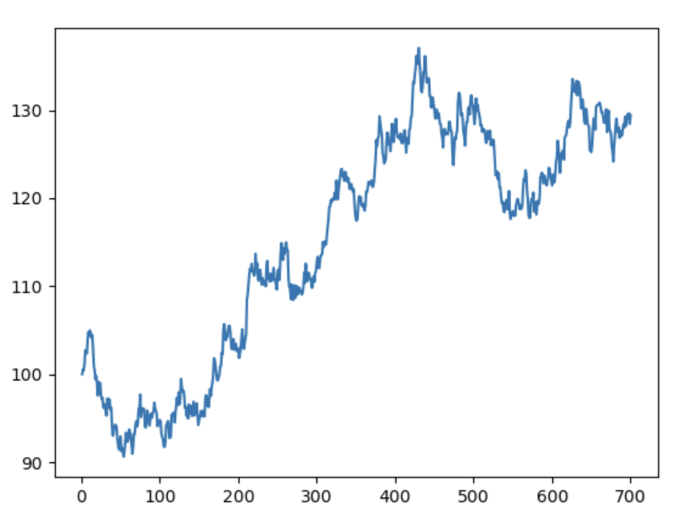
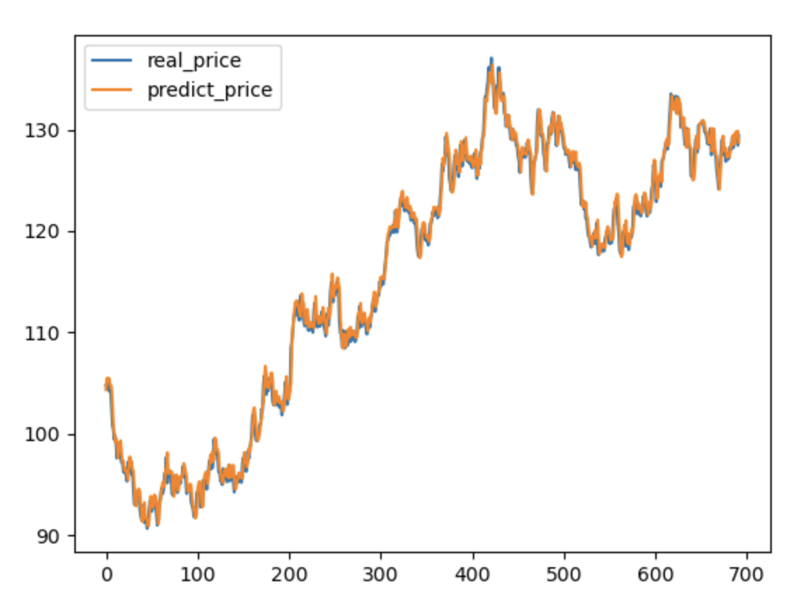

# 3.4. Recurrent Neural Network (RNN) In Practice - Predicting Stock Prices

This article continues from [3.2. Recurrent Neural Network (RNN) Theory (Basic)](<../3.2/3.2. Recurrent Neural Network (RNN) Theory (Basic).md>). If you have not read that one yet, it is recommended that you start there.

## 3.4.1. Preparation
Please run the following command in your terminal to install the required packages:
```bash
pip install keras tensorflow pandas
```

This article uses my `csv` file, which I uploaded to [GitHub](https://github.com/SomeB1oody/learning_examples/blob/main/deep_learning_example/3.4/simulated_stock_data.csv). Click the link to view and download it.

It contains two columns of information: one column is Time, representing time points from 1 to 700, for a total of 700 points; one column is Value, representing the stock price.

Just place the downloaded data in your Python project.

## 3.4.2. Model Details
Before we start coding, let's first settle a few model details:
- A single-layer RNN with 5 neurons in the output, and then one final output determined from the values of those 5 neurons
- Use the first eight data points each time to predict the ninth data point

## 3.4.3. Coding It Up
### Step 1: Read the Data
Use the `pandas` library to read the data and assign variables at the same time:
```python
# Load the data  
import pandas as pd  
data = pd.read_csv('simulated_stock_data.csv')  
  
prices = data.loc[:, 'Value']  
times = data.loc[:, 'Time']
```

Then use matplotlib to plot the raw data:
```python
# Visualize the raw data  
import matplotlib.pyplot as plt  
plt.plot(times, prices)  
plt.show()
```

Image output:



### Step 2: Normalize the Data
From the plot above, we can see that our data ranges from around 90 to around 130. The gap is too large, and it is easy to end up with a situation like a steep bowl with a flat bottom. To avoid this, we normalize the data by dividing by the maximum price, so values fall in $(0, 1]$ and gradient descent sees a smoother contour.
```python
# Normalize the data  
price_norm = prices / max(prices)
```

### Step 3: Extract X and y
As mentioned above, we use the first eight data points to predict the ninth point, so we need to extract the sequence data first. Every eight data points form a group, and these groups are stacked into a 2D array:
```python
# Extract X and y  
import numpy as np  
def extract_xy(data, time_step):  
    X, y = [], []  
    for i in range(len(data) - time_step):  
        X.append([a for a in data[i: i + time_step]])  
        y.append(data[i + time_step])  
    X = np.array(X)  
    X = np.reshape(X, (X.shape[0], X.shape[1], 1))  
    return X, y  
  
time_step = 8  
X, y = extract_xy(price_norm, time_step)
```
- `time_step` indicates how many consecutive data points are used as one input group to predict the next point. Here `time_step = 8`, so each input contains 8 values.

- The loop runs from `0` to `len(data) - time_step` to ensure it stays within array bounds. In each iteration:
  - `data[i: i + time_step]` extracts the consecutive `time_step` data points starting at position `i` (that is, 8 points) and stores them in `X`
  - `data[i + time_step]` extracts the value at position `i + time_step` as the target and stores it in `y`
  - For example: if `data = [1, 2, 3, 4, 5, 6, 7, 8, 9]` and `time_step = 3`, after running the loop we get `X = [[1, 2, 3], [2, 3, 4], [3, 4, 5], [4, 5, 6], [5, 6, 7], [6, 7, 8]]` and `y = [4, 5, 6, 7, 8, 9]`

- Finally, we use NumPy to reshape `X`:
  - For `X`, reshape it to `(samples, time_step, 1)`. Each sample represents a group of `time_step` values, and we add an extra dimension for the deep-learning model input, representing the number of features, which is 1 here
  - For `y`, keep it as a one-dimensional sequence of length `samples` (one target per input window). Keras accepts this format for a single regression output

### Step 4: Build and Configure the Model
Now we can build the RNN model. Remember to follow the requirements above: a single-layer RNN, 5 neurons in the output, and then one final output determined from the values of those 5 neurons:
```python
# Build the model  
from tensorflow.keras.models import Sequential  
from tensorflow.keras.layers import Dense, SimpleRNN  
  
model = Sequential()  
model.add(SimpleRNN(units=5, input_shape=(time_step, 1), activation='relu'))  
model.add(Dense(units=1, activation='linear'))  
model.compile(loss='mean_squared_error', optimizer='adam')  
model.summary()
```
- **SimpleRNN** layer:
    - `units=5`: defines the output dimension of the RNN as 5, which is the size of the hidden state in this layer
    - `input_shape=(time_step, 1)`:
        - `time_step=8` (defined in the previous code): indicates that the input has 8 time steps
        - `1`: indicates that the dimensionality of each time step is 1, because the normalized input is a scalar stock-price value and has only one column
    - `activation='relu'`: uses the ReLU activation function to encourage nonlinear modeling

- **Dense** layer:
    - `units=1`: defines the output dimension as 1, used to predict a single price value
    - `activation='linear'`: uses a linear activation so that the output is directly a numerical value, in the form of linear regression

- Compile the model:
	- `loss='mean_squared_error'`: uses mean squared error as the loss function, which is suitable for regression problems
    - `optimizer='adam'`: Adam optimizer, an optimization algorithm that combines momentum and adaptive learning-rate adjustment

- Print the model architecture:
	- `model.summary()` prints a summary of the model structure, including the name of each layer, output dimensions, and parameter counts

Output:
```
Model: "sequential"
┏━━━━━━━━━━━━━━━━━━━━━━━━━━━━━━━━━┳━━━━━━━━━━━━━━━━━━━━━━━━┳━━━━━━━━━━━━━━━┓
┃ Layer (type)                    ┃ Output Shape           ┃       Param # ┃
┡━━━━━━━━━━━━━━━━━━━━━━━━━━━━━━━━━╇━━━━━━━━━━━━━━━━━━━━━━━━╇━━━━━━━━━━━━━━━┩
│ simple_rnn (SimpleRNN)          │ (None, 5)              │            35 │
├─────────────────────────────────┼────────────────────────┼───────────────┤
│ dense (Dense)                   │ (None, 1)              │             6 │
└─────────────────────────────────┴────────────────────────┴───────────────┘
 Total params: 41 (164.00 B)
 Trainable params: 41 (164.00 B)
 Non-trainable params: 0 (0.00 B)
```

### Step 5: Train the Model
Just feed the data to the model:
```python
# Train the model  
model.fit(X, y, epochs=200, batch_size=32)
```

### Step 6: Training-Set Predictions
Finally, let's look at the model's predictions and overlay them on the original data to see how large the difference is:
```python
# Training-set prediction  
y_train_predict = model.predict(X) * max(prices)  
y_train = [i*max(prices) for i in y]  
  
import matplotlib.pyplot as plt  
plt.plot(y_train, label='real_price')  
plt.plot(y_train_predict, label='predict_price')  
plt.legend()  
plt.show()
```
- `* max(prices)`:
    - converts the predicted values back to their original scale
    - `max(prices)` is the maximum value used during normalization, and now it is used to map the prediction results back to the actual price range

Image output:



You can see that the result is pretty good, and the gap is not large.
