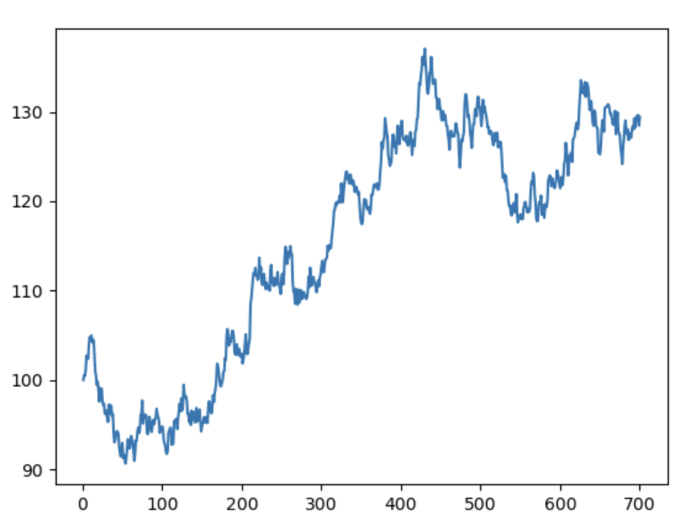
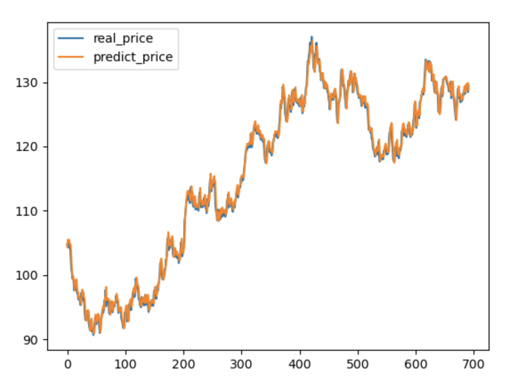

# 3.4. 循环神经网络(RNN)实战：预测股价

本文承接自上一篇文章 [3.2. 循环神经网络(RNN)理论(基础)](<../3.2/3.2. 循环神经网络(RNN)理论(基础).md>)，没看过的建议先看上文。

## 3.4.1. 准备工作
请在终端输入指令以下载和安装：
```bash
pip install keras tensorflow pandas
```

这里需要使用到我的`csv`文件，我把它上传到了[GitCode](https://gitcode.com/weixin_71793197/deep_learning_guide/blob/main/3.4/simulated_stock_data.csv)，你点击链接即可查看和下载。

它有2栏信息，一栏是Time，代表时间点，有1到700一共700个时间点；一栏是Value，代表股价。

把下载好后的数据放到你的Python项目下即可。

## 3.4.2. 模型细节
在正式敲代码之前，我们先来确定模型的一些细节：
- 单层RNN，输出有5个神经元，再基于这5个神经元的值来确定1个最终的输出
- 每次使用前八个数据预测第九个数据

## 3.4.3. 敲代码
### Step 1: 读取数据
使用`pandas`库来读取数据，顺便给变量赋值：
```python
# 读取数据  
import pandas as pd  
data = pd.read_csv('simulated_stock_data.csv')  
  
prices = data.loc[:, 'Value']  
times = data.loc[:, 'Time']
```

再使用matplotlib画出原始数据：
```python
# 可视化原始数据  
import matplotlib.pyplot as plt  
plt.plot(times, prices)  
plt.show()
```

图片输出：



### Step 2: 归一化处理
由上图可知，我们的数据最小在90左右，最大在130左右，数据的差距太大了，很容易出现像“碗边陡峭，底部平坦”的情况。为了避免这种情况，我们用最大值做归一化（把每个价格除以最大价格），使数值落在 $(0, 1]$ 区间内，这样在进行梯度下降时能让等高线更“圆滑”。
```python
# 数据归一化  
price_norm = prices / max(prices)
```

### Step 3: 提取X和y
上文讲到，每次使用前八个数据预测第九个数据，所以我们得先提取出序列数据，每八个数据形成一个小组，把这些组合在一起形成二维数组：
```python
# 提取X和y  
import numpy as np  
def extract_xy(data, time_step):  
    X, y = [], []  
    for i in range(len(data) - time_step):  
        X.append([a for a in data[i: i + time_step]])  
        y.append(data[i + time_step])  
    X = np.array(X)  
    X = np.reshape(X, (X.shape[0], X.shape[1], 1))  
    return X, y  
  
time_step = 8  
X, y = extract_xy(price_norm, time_step)
```
- `time_step` 表示用几个连续的数据作为一组输入，用来预测其后一个数据。这里的 `time_step = 8`，所以每次输入是 8 个值。

- 循环从`0`到`len(data) - time_step`（确保不会超出数组范围）。每次循环里：
  - `data[i: i + time_step]` 提取从第 `i` 个位置开始的连续 `time_step` （即 8 个）数据，作为一组输入序列，存入 `X`
  - `data[i + time_step]` 提取第 `i + time_step` 位置的数据，作为目标值，存入 `y`
  - 例如： 如果输入数据 `data = [1, 2, 3, 4, 5, 6, 7, 8, 9]` 且 `time_step = 3`，运行这个循环后：`X = [[1, 2, 3], [2, 3, 4], [3, 4, 5], [4, 5, 6], [5, 6, 7], [6, 7, 8]]`、`y = [4, 5, 6, 7, 8, 9]`

- 最后我们要使用numpy来调整`X`的形状:
  - 对于 `X`，调整形状为 `(样本, time_step, 1)`，每个样本表示一个包含 `time_step` 个数据的小组，并且增加一个额外维度（用于深度学习模型的输入，表示特征数量，这里是 1）
  - 对于 `y`，保持为一维序列，长度为 `样本数`（每个输入窗口对应一个目标值）。对单个回归输出，Keras 可以直接接受这种格式

### Step 4: 建立并配置模型
接下来我们就可以建立RNN模型了，记得按照上文的要求来（单层RNN，输出有5个神经元，再基于这5个神经元的值来确定1个最终的输出）：
```python
# 建立模型  
from tensorflow.keras.models import Sequential  
from tensorflow.keras.layers import Dense, SimpleRNN  
  
model = Sequential()  
model.add(SimpleRNN(units=5, input_shape=(time_step, 1), activation='relu'))  
model.add(Dense(units=1, activation='linear'))  
model.compile(loss='mean_squared_error', optimizer='adam')  
model.summary()
```
- **SimpleRNN** 层：
    - `units=5`: 定义 RNN 的输出维度为 5，即该层 RNN 的隐状态（hidden state）的大小
    - `input_shape=(time_step, 1)`:
        - `time_step=8`（在前面的代码中定义）：表示输入的数据有 8 个时间步
        - `1`：表示每个时间步的数据维度为 1（因为归一化后的输入对应的是价格值的标量，只有一列）
    - `activation='relu'`: 使用 ReLU 激活函数，鼓励非线性建模

- **Dense** 层：
    - `units=1`: 定义输出维度为 1，用于预测单个价格值
    - `activation='linear'`: 使用线性激活函数，使输出直接为一个数值（线性回归的形式）

- 编译模型：
	- `loss='mean_squared_error'`: 使用均方误差作为损失函数，适合回归问题
    - `optimizer='adam'`: Adam 优化器，结合了动量和自适应学习率调节的优化算法

- 打印模型架构：
	- `model.summary()`打印模型的结构概要，包括每一层的名称、输出维度和参数数量等

输出：
```
Model: "sequential"
┏━━━━━━━━━━━━━━━━━━━━━━━━━━━━━━━━━┳━━━━━━━━━━━━━━━━━━━━━━━━┳━━━━━━━━━━━━━━━┓
┃ Layer (type)                    ┃ Output Shape           ┃       Param # ┃
┡━━━━━━━━━━━━━━━━━━━━━━━━━━━━━━━━━╇━━━━━━━━━━━━━━━━━━━━━━━━╇━━━━━━━━━━━━━━━┩
│ simple_rnn (SimpleRNN)          │ (None, 5)              │            35 │
├─────────────────────────────────┼────────────────────────┼───────────────┤
│ dense (Dense)                   │ (None, 1)              │             6 │
└─────────────────────────────────┴────────────────────────┴───────────────┘
 Total params: 41 (164.00 B)
 Trainable params: 41 (164.00 B)
 Non-trainable params: 0 (0.00 B)
```

### Step 5: 训练模型
把数据喂给模型即可：
```python
# 训练模型  
model.fit(X, y, epochs=200, batch_size=32)
```

### Step 6: 训练集预测结果
最后我们看看模型预测出的结果，把它叠加在原始数据上看看差距大不大：
```python
# 训练集预测  
y_train_predict = model.predict(X) * max(prices)  
y_train = [i*max(prices) for i in y]  
  
import matplotlib.pyplot as plt  
plt.plot(y_train, label='real_price')  
plt.plot(y_train_predict, label='predict_price')  
plt.legend()  
plt.show()
```
- `* max(prices)`:
    - 将预测值反归一化，恢复到原始价格的范围
    - `max(prices)` 是归一化时使用的最大值，现在用于将预测结果映射回实际的价格范围

输出图片：



可以看出效果挺好的，差距不大。